# Moments Desktop / Laptop — v1 Product Requirements Document

## 1. Product Overview

Moments is a website to help people collect, organize and deliver photos in a more aumotamic way. 

The v1 release is an interactive frontend prototype for desktop and laptop screens, primarily 1024–1920px wide. This release has no backend, real authentication, cloud storage, or face recognition.

## 2. Function 1 — Account Setup and Privacy Onboarding

**First-time setup remains a two-step flow:**

First time when entering, get started to register or log in

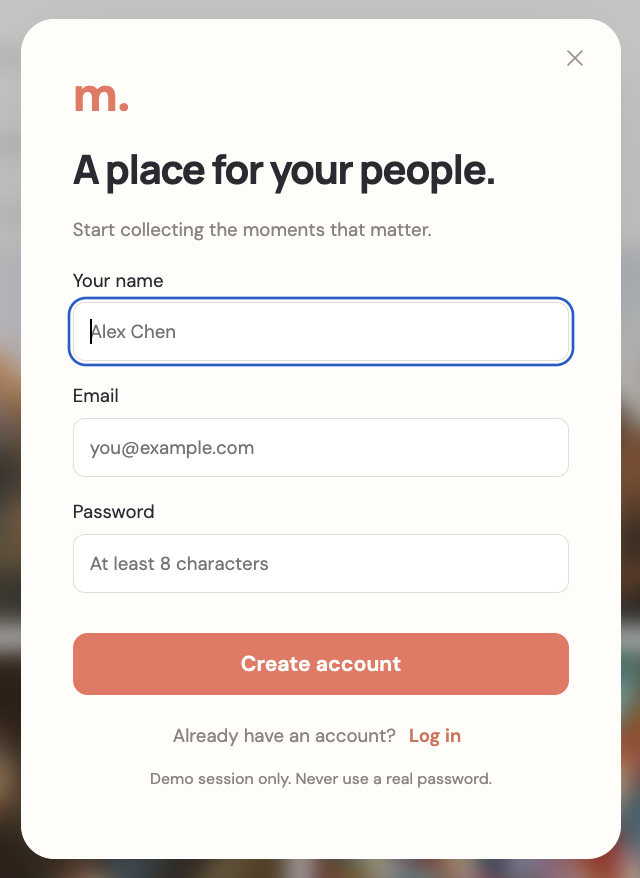

After creating account, there will be two-step set-up:

(1) enroll selfies:
The desktop step creates a QR code for a short-lived enrollment URL and waits for front, left-turn, and right-turn captures. The current frontend-only demo includes the responsive capture experience and same-browser completion through local storage, plus an explicit simulation control; it does not claim that a different device has synchronized. After onboarding, the standalone lock navigation and privacy dialog are removed. 

Clicking either profile avatar opens a desktop account-settings dialog. Selecting **My selfies** opens a dedicated face-settings dialog that mirrors setup step 1, shows the current enrollment state, and allows the user to replace all three reference angles without repeating the privacy step.

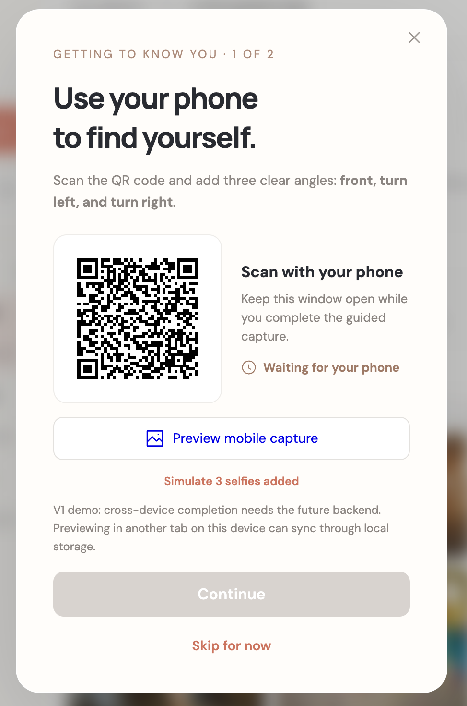

### Mobile Selfie Enrollment — Production Architecture

The production implementation may remain a responsive website; a native mobile app is not required for this use case. The desktop client creates a single-use enrollment session and encodes its short-lived URL in the QR code. The phone page uses `getUserMedia()` over HTTPS, guides the user through front, left-turn, and right-turn captures, performs basic quality checks, and uploads each compressed image through signed object-storage URLs. The desktop subscribes through SSE or WebSocket, or polls the session endpoint, until all three captures are accepted.

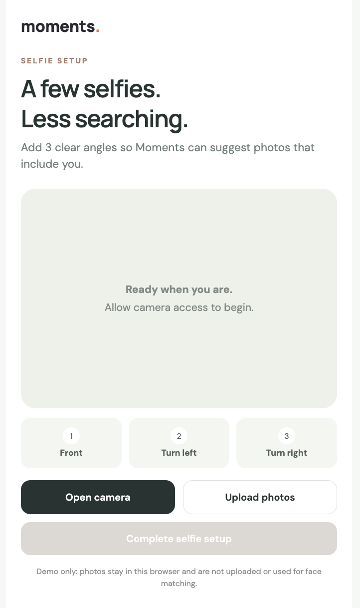

Required production endpoints:

| Method | Endpoint | Purpose |
| --- | --- | --- |
| POST | /face-enrollment/sessions | Create a user-bound, expiring, single-use session |
| GET | /face-enrollment/sessions/:id | Read waiting, capturing, uploading, completed, failed, or expired status |
| POST | /face-enrollment/sessions/:id/upload-url | Return a signed upload URL for one angle |
| POST | /face-enrollment/sessions/:id/complete | Validate all three captures and complete enrollment |
| DELETE | /face-enrollment/sessions/:id | Cancel enrollment and delete temporary captures |

(2)choose the two privacy permissions
users can customize the privacy permissions of Moments, or they can skip it now:

permission 1: **Use my face for matching**: Allow Moments to make a face signature from my selfies and compare it with photos in the app.
permission 2: **Match people in my uploads**Allow my event photos to be checked for members who opted in, so they can privately receive their photos

Clicking either profile avatar opens a desktop account-settings dialog and to adjust this privacy setting.

## 3. Function 2 — Create / Join Albums

### Create albums
Use the panel icon in the left navigation rail to show or hide the album sidebar. 
In the sidebar, click **Create an event** to open the album creation dialog.

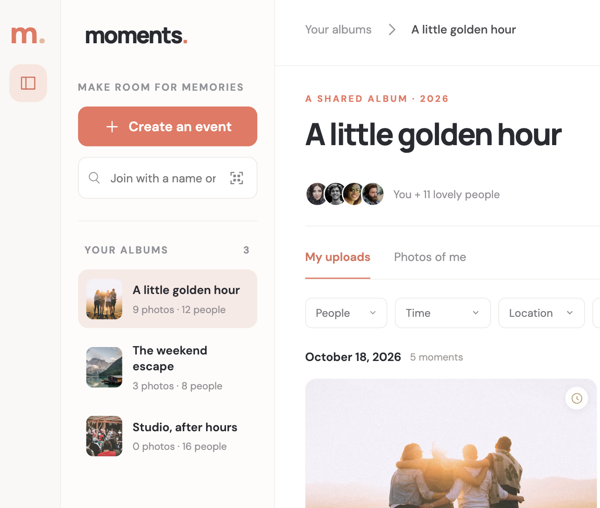

then there will be a floating card of an event album. 
Enter the name, date and location to initialize an event album.

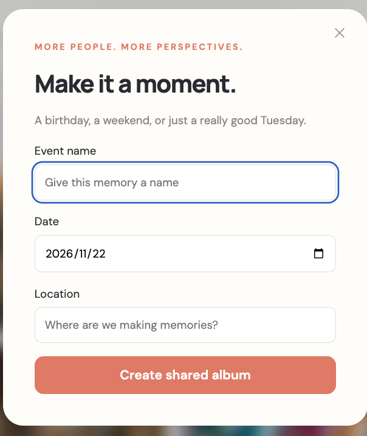

Users can also join an event album by searching invite code or scanning via QR code by clicking QR icon to upload it.

## 4. Function 3 — Shared Albums and Photo Delivery

### Album Photo Views

Each album has exactly two photo views: **My uploads** and **Photos of me**. There is also two main sub-functions: **Invite people** and **Add photos**.

#### My uploads

the default whenever the app opens, returns home, creates an album, or switches albums. 
##### Filter
Photos can be filtered by **People**, **Time**, **Location**, and **Status**. 

- **People:** Filter by recognized members or **Unsolved** faces.
- **Time:** Filter photos by capture date or event date.
- **Location:** Filter photos by available location metadata.
- **Status:** Filter by **Uploading**, **Sharing**, **Awaiting to share**, **Awaiting to deliver**, **Upload completed**, or **Delivery completed**.
- **My uploads:** Displays all four filters.
- Changing albums clears the current filters and returns the user to the default **My uploads** view.

**Acceptance criteria:**

- Selecting a filter updates the photo grid immediately.
- Combining filters returns only photos that satisfy every selected value.
- Empty results display a clear empty state.
- Reset restores the unfiltered results for the current photo view.
- Filters never expose photos outside the selected album or the user’s permitted view.

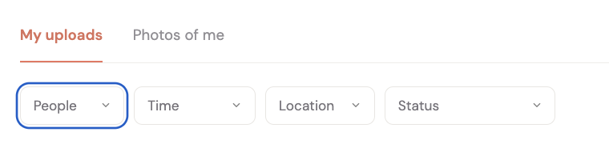

#### Photos of Me

Within the selected shared album, show a photo only when `containsMe` and `deliveredToMe` are true and `deliveryState` is completed. A match to another person or a saved bookmark must not make a photo eligible. v1 supplies explicitly labeled sample matching/delivery states; user uploads do not automatically qualify.

#### Album Invitations
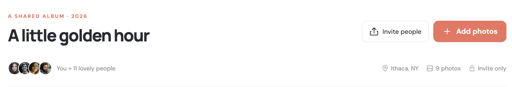

The invitation dialog: **invite people**

Offers two join methods: an invitation code and a QR image:

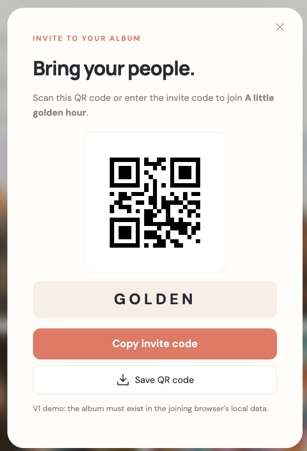

**Copy invite code** copies the code; **Save QR code** downloads a PNG. Custom events must already exist in the joining browser until a backend is available.
##### Filter
Displays only **Time** and **Location**, because this view already limits results to completed photos that were matched and delivered to the current user.

#### Add photos

The button: add photos
click this button to upload photos from computer.

### Photo hover: 
#### Photo Status

The top-right corner of each photo displays a **status icon**. The icon provides a compact visual summary; it does not represent every backend stage as a unique symbol. Multiple statuses may therefore share the same icon and are differentiated by color, animation, and tooltip text.

| Status              | Icon treatment                         | Eligibility                                                         |
| ------------------- | -------------------------------------- | ------------------------------------------------------------------- |
| Uploading           | Clock/progress icon, amber or animated | A photo is being read or queued for upload                          |
| Sharing             | Clock/progress icon, amber or animated | Sharing is in progress                                              |
| Awaiting to share   | Clock icon, amber                      | The photo is waiting to be shared                                   |
| Awaiting to deliver | Clock icon, amber                      | Delivery is pending                                                 |
| Upload completed    | Check icon, green                      | The upload stage is complete; in v1, the photo is available locally |
| Delivery completed  | Check icon, green                      | The delivery stage is complete                                      |
Users can view the complete status details through the **hover tooltip** on each photo’s status icon or through the **Transfer activity** floating card.

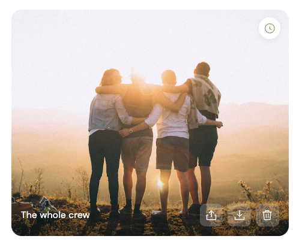
### Transfer Activity Popover
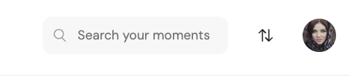
The top-bar bell is an upload/delivery transfer icon. Clicking it toggles a non-modal floating card anchored beneath the icon. Clicking outside, pressing Escape, or using Close dismisses it.

- Scope activity to the selected event and preserve the album, filters, and page position.
- Provide **Uploads** and **Delivery** views. Show a thumbnail, filename, status, and local-read progress for each photo.
- Group uploads into In progress, Waiting, Completed, and Failed. Group delivery into Delivered and Waiting for delivery.
- Use FileReader progress for actual device-local reads. Reject non-images and files over 5 MB. Allow retry of read failures while the selected File is still available in memory; after refresh, ask users to select interrupted files again.
- Sample photo delivery states are explicitly labeled as samples. Newly selected photos remain **Not delivered · backend unavailable**; completed local reads must never imply cloud upload or real delivery.
- Transfer metadata is stored with the local demo state. A future backend must supply upload progress, durable transfer jobs, and delivery results through the service boundary.

Acceptance: the icon toggles the card without navigation; both views list the selected album's photos; outside click and Escape close it; selecting files opens the queue; local-read completion updates the album and progress; the empty state offers guidance; real uploads never show a simulated successful delivery.

### Photo Sharing and Download
Clicking a photo's share control opens a centered floating dialog for Moments friends, Instagram, TikTok, Facebook, X, and copying the image link.

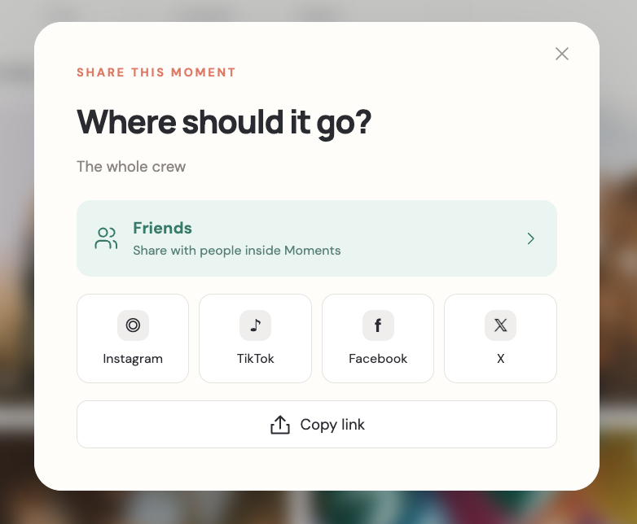

Moments friends use a distinct product color because they refer to relationships inside the website; external platforms use neutral styling. Facebook and X open their web share flows. Instagram and TikTok copy the image link before opening the platform because they do not provide equivalent desktop URL share composers. The adjacent download control downloads the image file instead of bookmarking it.

## 5. Canonical Technology Stack

This section is the single source of truth for the website's technology choices. Update it whenever the stack changes.

| Layer | v1 Technology | Purpose |
| --- | --- | --- |
| Markup | HTML5 | Semantic structure, forms, file inputs |
| Styling | CSS3 | Responsive grid/flex layouts, blurred overlays, hover states |
| Application logic | Native JavaScript ES Modules | State, interactions, service boundary |
| Local persistence | Web Storage / localStorage | Demo session, events, consent, photo data |
| Local images | FileReader / Data URLs | Uploaded-image previews and local persistence |
| QR generation | Bundled QR Code Generator (MIT), Kazuhiko Arase | Locally generate downloadable invitation QR PNGs |
| QR decoding | Browser BarcodeDetector API | QR decoding where available; invitation-code fallback elsewhere |
| Icons | Inline SVG | Icons without a library dependency |
| Typography | Google Fonts: DM Sans and Manrope | Interface fonts with system sans-serif fallback |
| Sample photos | Unsplash image URLs | Demo imagery only |
| Sample avatars | pravatar.cc | Demo member avatars |
| Hosting | Sites static hosting | Serve `dist` without a build step |

The project uses no React, Next.js, database, authentication SDK, or additional UI framework. Deployment metadata lives in `.openai/hosting.json`.

## 6. Reserved Backend API Contract

These endpoints describe future integration requirements; they are not implemented. Use the `/api/v1` prefix and JSON requests/responses. File uploads should use signed URLs.

`dist/services.js` is the designated service boundary and currently returns mock responses. Production integration must replace these methods, remove the fake session, and connect the UI's local array operations to service responses. Local storage must never determine production permissions.

| Method | Endpoint | Request | Response |
| --- | --- | --- | --- |
| POST | /auth/signup | name, email, password | user; HttpOnly session cookie |
| POST | /auth/login | email, password | user; HttpOnly session cookie |
| POST | /auth/logout | None | 204; revoke session |
| GET | /me | None | user, onboardingCompleted |
| GET / PATCH | /me/privacy | useFace, matchUploads, consentVersion | choices, updatedAt |
| POST | /me/selfies/upload-url | filename, contentType, size | uploadUrl, assetId, expiresAt |
| POST | /me/selfies | assetIds; maximum five | selfieIds |
| DELETE | /me/face-signature | None | 204; delete biometric signature and stop subsequent matching |
| GET / POST | /events | name, date, location for creation | Event[] / Event |
| GET | /events/search?q= | name or inviteCode | Limited metadata for joinable events |
| POST | /events/join | inviteCode | Event, membership |
| POST | /events/:id/invites | expiresAt | inviteCode, inviteUrl, qrPayload |
| GET | /events/:id/photos | people, time, location, status, photosOfMe, cursor | photos, nextCursor |
| POST | /events/:id/photos/upload-url | filename, contentType, size | uploadUrl, assetId |
| POST | /events/:id/photos | assetId, metadata | Photo with pending status |
| DELETE | /photos/:id | None | 204; validate deletion permissions on the server |
| PUT / DELETE | /photos/:id/saved | None | saved |
| POST | /photos/:id/share | expiresAt | Expiring, revocable shareUrl |
| POST | /matching/jobs | photoIds | jobId, pending; validate applicable consent on the server |
| GET | /matching/jobs/:id | None | pending / complete / failed |

### Data Models

- **Event:** id, name, date, location, cover, members, code, joined.
- **Photo:** id, eventId, url, name, person, status, date, location, type, owner, saved, workflowVersion, uploadState, shareState, deliveryState, containsMe, deliveredToMe.
- **Privacy:** useFace, matchUploads, updatedAt. Production must also record consentVersion.

### Error and Authorization Requirements

Use `{ error: { code, message, field? } }` as the production error envelope. Handle 401 with reauthentication, 403 with an access-denied message, 413 with a file-size message, 422 with validation feedback, and 429 with retry guidance.

The server must validate event membership, applicable consent, and resource ownership. Production biometric processing requires its own storage, retention, and deletion policies. Raw facial features must not be stored in localStorage.

## 7. Deployed Website and Verification

The v1 prototype is deployed on Sites:

[Open Moments](https://moments-desktop-studio.whalefall213.chatgpt.site)

Use the acceptance criteria in Tasks 1 and 2 to verify the deployed experience. Include a page refresh to verify that demo state persists in the same browser.

## 8. v1 Constraints

- Data belongs to the local browser, not a verified account. This release does not provide cross-user collaboration or real authentication.
- localStorage has a limited capacity, commonly a few megabytes. Large photos may exhaust it; the app reports this and keeps the current in-memory preview. Clearing site data resets the demo.
- Sample photos, avatars, and fonts require external network access. Production should use owned assets and controlled storage.
- QR decoding depends on browser support. A valid local invitation result must be selected before joining.
- Photo sharing copies a sample image URL without access control or revocation. Production must use the authorized sharing endpoint.
- Time, location, type, and recognized-person values are demo metadata. Uploaded photos are not analyzed in v1.
